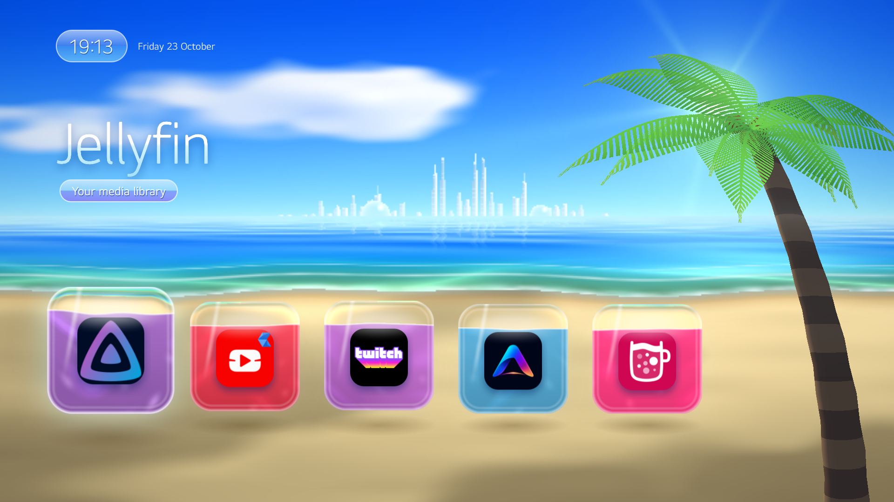
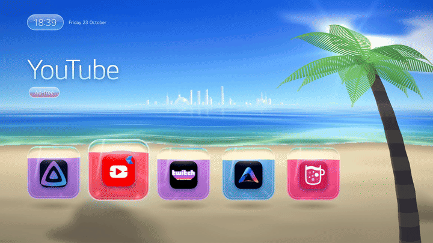

# webos-aero-home

A custom home screen for **rooted LG webOS TVs**: a Sega-Dreamcast / Frutiger-Aero beach with
live water shaders, a 3D palm tree, a glass city on the horizon, liquid-glass app tiles that slosh
when you move, an ambient beach soundtrack and PS2-style menu sounds. It replaces LG's home
(the HOME button opens it, it starts at boot), and comes with a small ad/telemetry blocklist.





It is a **native QML app** that runs on LG's own UI engine (`qml-runner`, Qt 5.12), not a web
page: it starts in ~350 ms and holds 60 fps on an LG C1.

> **Not a custom OS.** There is no custom firmware for LG TVs and you should never flash
> anything. This is webOS + root (Homebrew Channel) + one extra app and a few startup scripts.
> Everything here can be undone; nothing on the TV's system partition is modified.

> **Use at your own risk.** Rooting may void your warranty. Blocking firmware updates (which you
> will want, so updates don't remove root) also means no security updates. This project is not
> affiliated with LG.

---

## Contents

- [What you need](#what-you-need)
- [Step 0 – Root the TV](#step-0--root-the-tv)
- [Step 1 – SSH access with a key](#step-1--ssh-access-with-a-key)
- [Step 2 – Configure this repo](#step-2--configure-this-repo)
- [Step 3 – Install the home](#step-3--install-the-home)
- [Step 4 – Make HOME open it](#step-4--make-home-open-it)
- [Step 5 – Start at boot + ad blocklist](#step-5--start-at-boot--ad-blocklist)
- [Choosing your apps](#choosing-your-apps)
- [Undo everything](#undo-everything)
- [Troubleshooting](#troubleshooting)
- [Making a trailer video](#making-a-trailer-video)
- [How it works](#how-it-works)
- [Credits & licences](#credits--licences)

---

## What you need

| | |
|---|---|
| **TV** | An LG webOS TV that can be rooted. Developed and tested on an **LG C1 (OLED55C1, webOS 6.5)**. Other webOS 5/6 models should work; webOS 22+ is untested. |
| **Computer** | Linux or macOS (Windows: use WSL) with `ssh`, `scp`, `curl`, `python3`. For the audio step: [`uv`](https://docs.astral.sh/uv/) *or* Python with `numpy`. |
| **Network** | TV and computer on the same network. |

## Step 0 – Root the TV

This repo does **not** root your TV. Root depends on your exact model and firmware, and the
exploits change as LG patches them, so follow the official, maintained guides:

1. Find your model and firmware: TV **Settings → Support → TV Information**.
2. Check whether it can be rooted and with which method: **https://cani.rootmy.tv**
3. Follow the matching guide on **https://www.webosbrew.org/rooting/** – this installs the
   **Homebrew Channel** with root.
4. In **Homebrew Channel → Settings**:
   - **Block system updates: ON** (otherwise an update can remove root)
   - **Enable SSH server: ON**
   - **Telnet: OFF** (telnet is an unauthenticated root shell on your network)
   - **Failsafe mode: leave ON** (it rescues you if a startup script ever breaks boot)

If cani.rootmy.tv says your firmware can't be rooted, stop here – there is no safe workaround.

## Step 1 – SSH access with a key

Homebrew Channel's SSH server (port 22) logs in as `root`. Use a key, not a password:

```bash
# on your computer: make a key for the TV (no passphrase, or use ssh-agent)
ssh-keygen -t ed25519 -f ~/.ssh/id_ed25519_lgtv -C lgtv

# copy the PUBLIC key to the TV. The first time you need the root password
# (Homebrew sets "alpine" until you add a key – see webosbrew.org if yours differs)
cat ~/.ssh/id_ed25519_lgtv.pub | ssh root@<TV-IP> 'mkdir -p /home/root/.ssh && cat >> /home/root/.ssh/authorized_keys && chmod 600 /home/root/.ssh/authorized_keys'

# test
ssh -i ~/.ssh/id_ed25519_lgtv root@<TV-IP> 'uname -a'
```

Find the TV's IP in **Settings → General → Network → (Wi-Fi/Wired) → Advanced settings**.
Giving it a fixed IP in your router is a good idea.

After adding a key, **reboot the TV once**: Homebrew then stops using the default password.

## Step 2 – Configure this repo

```bash
git clone https://github.com/damos1212/webos-aero-home && cd webos-aero-home
cp config.example.sh config.sh
nano config.sh        # TV_HOST = your TV's IP, SSH_KEY = ~/.ssh/id_ed25519_lgtv
```

`config.sh` is git-ignored, so your IP and key path never end up in git.

## Step 3 – Install the home

```bash
tools/make-audio.sh        # generates home/tld.my.home/ambient.wav (~5 s, needs uv or numpy)
tools/deploy.sh            # builds the .ipk, installs it, sets permissions, starts it
```

`deploy.sh` also:
- grants the app permission to launch other apps (`tools/qml-perms.sh`, see
  [How it works](#how-it-works)),
- runs a QML check on the TV (`tools/qml-check.sh`) – errors are printed, because LG's
  `qml-runner` otherwise fails silently,
- restarts the app so HOME can always bring it back.

`tools/deploy.sh "" shot.png` also saves a screenshot from the TV.

At this point the home runs, but HOME still opens LG's home. Next step fixes that.

## Step 4 – Make HOME open it

```bash
tools/install-inputhook.sh
```

This downloads **LG Input Hook v1.4.0** from its official GitHub release, checks its SHA-256,
and installs **only the hook** (not the app). The hook sits in the TV's remote-input process and
turns the HOME key into "launch this home" before LG's home ever sees it.

Why not just install the Input Hook app from Homebrew? Its settings page is a small web server on
port 1842 that, among other things, lets anything that can talk to it read and write any file as
root. The hook alone doesn't need it.

**Different remote?** HOME is code `773` on the LG Magic Remote MR21. If HOME does nothing after
this step, find your code (see [Troubleshooting](#home-does-nothing-after-step-4)) and run
`HOME_KEY=<code> tools/install-inputhook.sh`.

## Step 5 – Start at boot + ad blocklist

```bash
tools/install-tv.sh
```

Installs two Homebrew startup scripts (`/var/lib/webosbrew/init.d`):

| Script | What it does |
|---|---|
| `55-aero-home` | starts the home at boot, and whenever LG's own Home appears (e.g. after power-on), replaces it with this one |
| `40-lg-blocklist` | blocks LG ad/telemetry domains in the TV's in-memory hosts file (`tv/lg-blocklist.sh` lists them). App stores, sign-ins and streaming apps are not affected |

Optional privacy settings on the TV itself (no root needed): **Settings → General → System →
Additional Settings** – turn off **Live Plus**, **Home Promotion**, **Content Recommendation**;
under **User Agreements** untick Viewing Information / Voice / Interest-Based Ads.

## Choosing your apps

The tiles are defined at the top of `home/tld.my.home/main.qml`:

```qml
{ id: "youtube.leanback.v4", title: "YouTube", subtitle: "Ad-free",
  icon: devApps + "youtube.leanback.v4/yt_lg_130x130.png", accent: "#ff3355" },
```

- **id** – the app's id. List all installed apps with
  `ssh -i <key> root@<TV-IP> "luna-send -n 1 luna://com.webos.applicationManager/listApps '{}'"`
- **icon** – a PNG inside the installed app (look in its `appinfo.json` for `largeIcon`).
  `devApps` points at Homebrew/dev apps (`/media/developer/apps/usr/palm/applications/`).
  For apps from the LG Content Store use
  `"file:///media/cryptofs/apps/usr/palm/applications/<id>/<icon>.png"`.
- **accent** – the colour of the tile's liquid and the light around it.

The tiles shown in the screenshot are YouTube AdFree, Twitch AdFree, Jellyfin, Aurora (Moonlight)
and Homebrew Channel – all installable from Homebrew Channel. Then run `tools/deploy.sh` again.

## Undo everything

| What | Undo |
|---|---|
| Boot start + LG-Home takeover + blocklist | `tools/install-tv.sh uninstall` |
| HOME button | `tools/install-inputhook.sh uninstall` (reboot to fully detach the hook) |
| The home app | `ssh … "luna-send -n 1 luna://com.webos.appInstallService/dev/remove '{\"id\":\"tld.my.home\"}'"` |
| App permissions | `ssh … /var/lib/aero-home/qml-perms.sh tld.my.home --remove` (before removing the app) |
| Root itself | see webosbrew.org (a factory reset removes Homebrew Channel) |

## Troubleshooting

#### The screen is black / LG's home shows instead
Run `ssh … /var/lib/aero-home/qml-check.sh tld.my.home`. `qml-runner` exits silently on any QML
error; this prints it. (Classic mistake when editing: declaring a property with a built-in name
such as `width`, `focus` or `left` → "Cannot override FINAL property".)

#### HOME does nothing after Step 4
Watch the hook's log while pressing buttons:
`ssh … tail -f /tmp/lginput-hook-lginput2.log` – each press prints `<code> => 1`. Use the code
you see for HOME with `HOME_KEY=<code> tools/install-inputhook.sh`. If nothing is printed, check
`/tmp/aero-home-inputhook.log` and `/tmp/ezinject-lginput2.log`.

#### HOME stops bringing the home back from an app
The running home instance was started before its permissions were applied (e.g. you installed
it by hand). Restart it once:
`ssh … "luna-send -n 1 luna://com.webos.applicationManager/closeByAppId '{\"id\":\"tld.my.home\"}'"`,
then press HOME. `tools/deploy.sh` always does this for you.

#### App tiles don't launch anything
The permissions step didn't apply: run `ssh … /var/lib/aero-home/qml-perms.sh tld.my.home`
and restart the app as above.

#### Show the frame rate
`ssh … "touch /tmp/home-fps"`, then restart the app: an FPS counter appears top-right.
Remove the file and restart to hide it.

#### No sound
The ambience and menu sounds play through the TV's normal output. Check the TV's sound output
setting, and that `ambient.wav` exists (`tools/make-audio.sh`).

## Making a trailer video

`trailer/` renders the real home QML headlessly on a Linux PC (Xvfb + PySide2 via `uv`), with a
scripted demo (scroll across the tiles, select YouTube), mixes the matching audio and encodes an
MP4. Rendering on the TV itself is too heavy.

```bash
trailer/fetch_assets.sh     # copies LG's UI font + your app icons from YOUR TV (not in git)
trailer/make_trailer.sh     # -> trailer/out/home-trailer.mp4
```

Needs: Debian/Ubuntu-like Linux with `xvfb-run`, `ffmpeg`, `uv`, and `apt download` (the script
fetches one missing Qt dependency locally, no root needed).

## How it works

- **The home** (`home/tld.my.home`) is a QML app (`"type": "qml"` in `appinfo.json`), run by
  LG's `/usr/bin/qml-runner`. The beach, sea, clouds and glass city are one fragment shader
  (`Ocean.qml`) rendered at 640×360 and scaled up; the palm is real 3D geometry generated in
  vertex shaders (`Palm3D.qml`, Qt 5.12 has no Qt Quick 3D); each tile refracts the scene behind
  it and holds a sloshing liquid (`GlassCard.qml`). All animation clocks are vsync-locked.
- **Permissions.** Dev QML apps get no role on the TV's system bus, so their calls are silently
  dropped. `tools/qml-perms.sh` adds the same kind of role/permission files LG's own QML
  screensaver has, allowing the app to launch apps (group `applications.launch`).
- **HOME button.** LG Input Hook's `ezinject` loads a small PHP/FFI hook into `lginput2` (the
  remote-input daemon). Our boot script (`tv/inputhook-start.sh`) re-attaches it at each boot.
- **Lifecycle.** The app registers with the app manager like LG's QML apps (`registerApp`,
  `getAppLifeEvents`) and shows itself on relaunch.
- **Audio** is synthesised by `tools/gen_ambient.py` / `tools/gen_sfx.py` (no samples): Y2K pad
  chords, glass bells, waves, birds; played as a seamless in-memory loop through PulseAudio so it
  doesn't take a hardware decoder away from YouTube/Netflix.

## Credits & licences

- This project: **MIT** (see `LICENSE`). The generated audio is part of it.
- **LG Input Hook** by Simon34545 – https://github.com/Simon34545/lginputhook (BSD). Downloaded at
  install time, not included here.
- **Homebrew Channel / webOS Homebrew Project** – https://www.webosbrew.org
- **LG**, **webOS** and the **LG Smart UI** font belong to LG Electronics. App names/icons belong
  to their owners; the trailer script copies them from your own TV and they are never committed.
